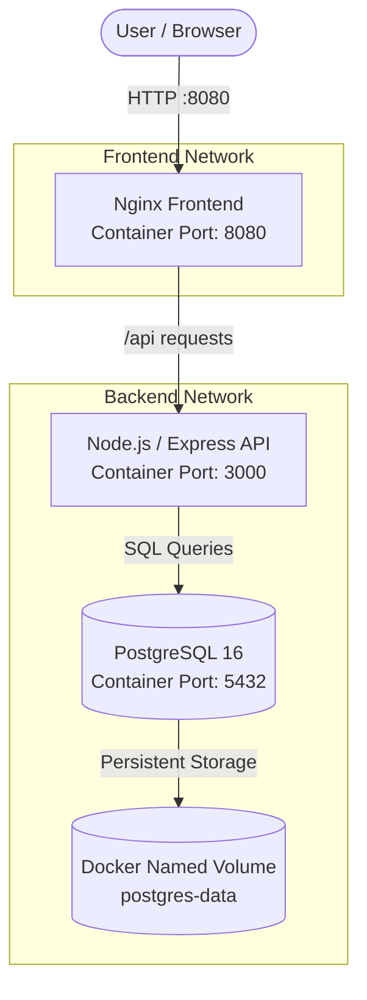

# Zidd — Dockerized Notes Application

A practical three-tier application built to understand Docker, containerization, networking, persistent storage, and core DevOps workflows.

Zidd is a Notes application built using an Nginx frontend, Node.js/Express backend, and PostgreSQL database. Each component runs in its own container and communicates through isolated Docker networks.

The application uses Docker Compose to manage all three services and Docker Hub to distribute the prebuilt application images.

**Technologies:** Docker · Docker Compose · Nginx · Node.js · Express · PostgreSQL · Linux · Git · GitHub · Docker Hub

---

## Table of Contents

1. [Application Overview](#1-application-overview)
2. [Application Architecture](#2-application-architecture)
3. [Docker Networking and Isolation](#3-docker-networking-and-isolation)
4. [Project Structure](#4-project-structure)
5. [Prerequisites](#5-prerequisites)
6. [Quick Start — Run the Application](#6-quick-start--run-the-application)
7. [API Reference](#7-api-reference)
8. [Database Persistence](#8-database-persistence)
9. [Useful Docker Commands](#9-useful-docker-commands)
10. [Docker Hub Images](#10-docker-hub-images)
11. [Security and Configuration](#11-security-and-configuration)
12. [DevOps Concepts Demonstrated](#12-devops-concepts-demonstrated)
13. [Future Improvements](#13-future-improvements)
14. [Author](#14-author)

---

## 1. Application Overview

Zidd follows a three-tier architecture. Each service has a separate responsibility.

| Service | Technology | Responsibility |
|---|---|---|
| Frontend | Nginx Unprivileged Alpine | Serves the web interface and forwards API requests |
| Backend | Node.js 22 + Express 5 | Handles application logic and REST API requests |
| Database | PostgreSQL 16 Alpine | Stores notes and creation timestamps |

### Why use three separate containers?

Instead of putting the entire application into one container, each component runs independently.

This provides:

- **Isolation:** Each service has its own environment.
- **Maintainability:** Each component can be updated independently.
- **Scalability:** Services can be scaled independently when needed.
- **Resource management:** Memory limits can be configured per service.
- **Reusability:** Application images can be distributed through Docker Hub.

---

## 2. Application Architecture

### Architecture Diagram



### How Does a Request Travel?

Consider a user creating a note through the browser.

1. The browser sends an HTTP request to Nginx on port `8080`.
2. Nginx serves the frontend interface.
3. When the frontend makes an API request, Nginx forwards it to the backend.
4. The Node.js backend processes the request.
5. The backend connects to PostgreSQL using the Docker Compose service name `db`.
6. PostgreSQL stores the note in the database.
7. The backend returns the response through Nginx to the browser.

### How Does Docker Resolve Service Names?

The backend connects to PostgreSQL using:

```text
DB_HOST=db
DB_PORT=5432
```

Here, `db` is the service name defined in Docker Compose.

Docker provides internal DNS resolution, which allows containers on the same Docker network to communicate using service names instead of hard-coded IP addresses.

---

## 3. Docker Networking and Isolation

The application uses two user-defined bridge networks.

| Network | Connected Services | Purpose |
|---|---|---|
| frontend-net | Frontend and Backend | Allows frontend-to-backend communication |
| backend-net | Backend and Database | Allows backend-to-database communication |

### Why Two Networks?

The backend needs to communicate with both the frontend and database.

Therefore, it belongs to both networks.

The frontend and database do not share a network. This prevents direct communication between these two services through Docker networking.

### Port Mapping

Only the frontend publishes a port to the host:

```yaml
ports:
  - "8080:8080"
```

This means:

- Host port: `8080`
- Frontend container port: `8080`

The backend and database ports are not published to the host. They are accessible through their respective internal Docker networks.

---

## 4. Project Structure

```text
Dockerized-Notes-application/
│
├── backend/
│   ├── .dockerignore
│   ├── Dockerfile
│   ├── package.json
│   ├── package-lock.json
│   └── server.js
│
├── frontend/
│   ├── Dockerfile
│   ├── default.conf
│   └── index.html
│
├── docs/
│   └── images/
│
├── .env.example
├── .gitignore
├── LICENSE
├── docker-compose.yml
└── README.md
```

### Important Files

| File | Purpose |
|---|---|
| `backend/Dockerfile` | Defines how to build the backend image |
| `backend/server.js` | Contains the Express API and database operations |
| `frontend/Dockerfile` | Defines how to build the frontend image |
| `frontend/default.conf` | Configures Nginx and API reverse proxying |
| `frontend/index.html` | Contains the Notes application interface |
| `docker-compose.yml` | Defines and orchestrates the three services |
| `.env.example` | Provides a template for environment variables |
| `.gitignore` | Prevents sensitive and unnecessary files from being committed |

---

## 5. Prerequisites

Before running the application, install:

- Docker Engine
- Docker Compose v2
- Git

Verify your installations:

```bash
docker --version
docker compose version
git --version
```

You do not need to install Node.js, npm, or PostgreSQL separately on your computer. These components run inside their respective containers.

---

## 6. Quick Start — Run the Application

You can run Zidd using the prebuilt Docker images published on Docker Hub.

You do not need to build the frontend or backend images manually.

### Step 1 — Clone the Repository

```bash
git clone https://github.com/kartikkalyanshetti/Dockerized-Notes-application.git

cd Dockerized-Notes-application
```

### Step 2 — Configure Environment Variables

Create your environment file using the provided example:

```bash
cp .env.example .env
```

Open `.env` in your preferred text editor and configure your database credentials.

Example:

```env
# PostgreSQL container configuration
POSTGRES_DB=notesdb
POSTGRES_USER=notesuser
POSTGRES_PASSWORD=your_strong_password

# Backend database connection
DB_HOST=db
DB_PORT=5432
DB_NAME=notesdb
DB_USER=notesuser
DB_PASSWORD=your_strong_password
```

**Important:**

- `POSTGRES_DB` must match `DB_NAME`.
- `POSTGRES_USER` must match `DB_USER`.
- `POSTGRES_PASSWORD` must match `DB_PASSWORD`.
- Replace the example password with your own strong password.
- Never upload your actual `.env` file to GitHub.

### Step 3 — Download Docker Images

Pull the published application images and the PostgreSQL image:

```bash
docker compose pull
```

Docker downloads:

| Component | Image |
|---|---|
| Frontend | `kartik1160/notes-frontend:1.0` |
| Backend | `kartik1160/notes-backend:1.0` |
| Database | `postgres:16-alpine` |

### Step 4 — Start the Application

```bash
docker compose up -d
```

Docker Compose automatically:

1. Creates the application networks.
2. Creates the PostgreSQL named volume if it does not exist.
3. Starts the database.
4. Waits for the database health check to pass.
5. Starts the backend.
6. Waits for the backend health check to pass.
7. Starts the frontend.

The `-d` option runs containers in detached mode, meaning they continue running in the background.

### Step 5 — Verify Container Status

```bash
docker compose ps
```

Expected services:

| Service | Expected Status |
|---|---|
| Database | Up (healthy) |
| Backend | Up (healthy) |
| Frontend | Up |

### Step 6 — Open the Application

Open your browser and visit:

**http://localhost:8080**

Your Notes application is ready!

### Quick Start Summary

For someone who already has Docker and Git installed, the basic workflow is:

```bash
git clone https://github.com/kartikkalyanshetti/Dockerized-Notes-application.git

cd Dockerized-Notes-application

cp .env.example .env

# Edit .env and configure your database password

docker compose pull

docker compose up -d
```

Then open:

```text
http://localhost:8080
```

---

## 7. API Reference

The backend exposes the following REST API endpoints.

| Method | Endpoint | Description |
|---|---|---|
| GET | `/api/health` | Checks API and database connectivity |
| GET | `/api/notes` | Retrieves all saved notes |
| POST | `/api/notes` | Creates a new note |

### 7.1 Check API Health

```bash
curl http://localhost:8080/api/health
```

Expected response:

```json
{
  "status": "healthy",
  "database": "connected"
}
```

This endpoint checks whether the backend can communicate with PostgreSQL.

### 7.2 Retrieve Notes

```bash
curl http://localhost:8080/api/notes
```

This returns the saved notes from the database.

### 7.3 Create a Note

```bash
curl -X POST http://localhost:8080/api/notes \
  -H "Content-Type: application/json" \
  -d '{"content":"My first note from the API"}'
```

The backend validates the content and stores the note in PostgreSQL.

---

## 8. Database Persistence

PostgreSQL stores its database files inside a Docker named volume called:

```text
postgres-data
```

The volume is mounted inside the database container at:

```text
/var/lib/postgresql/data
```

### Why Do We Need Docker Volumes?

A container's writable filesystem is tied to that container's lifecycle.

If a database container is removed, data stored only inside its writable layer can be lost.

Docker named volumes solve this problem by storing data separately from the container.

This allows database information to survive container recreation.

### Test Database Persistence

1. Create a note through the application.
2. Stop and remove the containers:

   ```bash
   docker compose down
   ```

3. Start the application again:

   ```bash
   docker compose up -d
   ```

4. Retrieve your notes:

   ```bash
   curl http://localhost:8080/api/notes
   ```

The previously created note should still exist.

**Important:** 

```bash
docker compose down -v
```

removes the Compose-managed named volume and deletes the stored database data.

Use it only when you intentionally want to reset the database.

---

## 9. Useful Docker Commands

### Check Running Services

```bash
docker compose ps
```

### View All Application Logs

```bash
docker compose logs
```

### Follow Backend Logs

```bash
docker compose logs -f backend
```

### Follow Database Logs

```bash
docker compose logs -f db
```

### Follow Frontend Logs

```bash
docker compose logs -f frontend
```

### Monitor Container Resource Usage

```bash
docker stats
```

### Pull Updated Images

```bash
docker compose pull
```

### Restart All Services

```bash
docker compose restart
```

### Stop and Remove Containers

```bash
docker compose down
```

This removes containers and project networks but preserves the named database volume.

---

## 10. Docker Hub Images

The frontend and backend images are published on Docker Hub.

This allows other users to download and run the application without building the images locally.

### Frontend Image

**Image:**

```text
kartik1160/notes-frontend:1.0
```

Docker Hub:

https://hub.docker.com/r/kartik1160/notes-frontend

Pull manually:

```bash
docker pull kartik1160/notes-frontend:1.0
```

### Backend Image

**Image:**

```text
kartik1160/notes-backend:1.0
```

Docker Hub:

https://hub.docker.com/r/kartik1160/notes-backend

Pull manually:

```bash
docker pull kartik1160/notes-backend:1.0
```

### Database Image

The project uses the official PostgreSQL image:

```text
postgres:16-alpine
```

Docker Compose downloads it automatically.

### Why Publish Docker Images?

Publishing images to Docker Hub provides several benefits:

- Images can be reused across different machines.
- Users do not need the application source code to run the containers.
- Deployment becomes faster and simpler.
- Image versions can be managed using tags.
- Developers can distribute application images through a central registry.

The Dockerfiles remain available in this repository for anyone who wants to study or modify the image-building process.

---

## 11. Security and Configuration

This project incorporates several basic container security practices.

| Practice | Implementation |
|---|---|
| Environment variables | Database credentials are configured through `.env` |
| Secret protection | `.env` is excluded from Git |
| Non-root backend | Backend runs using a dedicated non-root user |
| Unprivileged frontend | Uses `nginxinc/nginx-unprivileged:stable-alpine` |
| Network isolation | Frontend and database use separate networks |
| Internal services | Backend and database ports are not published to the host |
| Health checks | Database and backend health checks |
| Resource management | Memory limits configured for each service |

**Security reminder:** `.env.example` is safe to publish because it contains placeholder credentials. Never commit real passwords or secrets.

---

## 12. DevOps Concepts Demonstrated

This project demonstrates several important DevOps concepts through practical implementation.

| Concept | How It Is Used |
|---|---|
| Containerization | Dockerfiles for frontend and backend |
| Orchestration | Docker Compose manages three services |
| Networking | User-defined bridge networks |
| Service Discovery | Docker internal DNS |
| Reverse Proxy | Nginx forwards API requests |
| Database Management | PostgreSQL |
| Persistent Storage | Docker named volumes |
| Health Monitoring | Docker health checks |
| Security | Non-root users and environment variables |
| Resource Management | Container memory limits |
| Image Registry | Docker Hub |
| Deployment | Pulling and running published images |
| Version Control | Git and GitHub |
| Linux | Container deployment and management |

---

## 13. Future Improvements

Possible improvements for this project:

- Add automated backend and API tests.
- Implement CI/CD using GitHub Actions.
- Deploy the application on AWS EC2.
- Provision infrastructure using Terraform.
- Add monitoring using Prometheus and Grafana.
- Configure a domain name and HTTPS.
- Implement automated image versioning.
- Add vulnerability scanning for Docker images.

---

## 14. Author

**Kartik Kalyanshetti**

A hands-on learning project focused on Docker, Linux, networking, application deployment, and DevOps fundamentals.

**Project Links**

- GitHub Repository: https://github.com/kartikkalyanshetti/Dockerized-Notes-application
- Docker Hub — Frontend: https://hub.docker.com/r/kartik1160/notes-frontend
- Docker Hub — Backend: https://hub.docker.com/r/kartik1160/notes-backend

---

*Built as a practical project to understand how real-world applications are containerized, connected, deployed, and managed using Docker and Docker Compose.*
