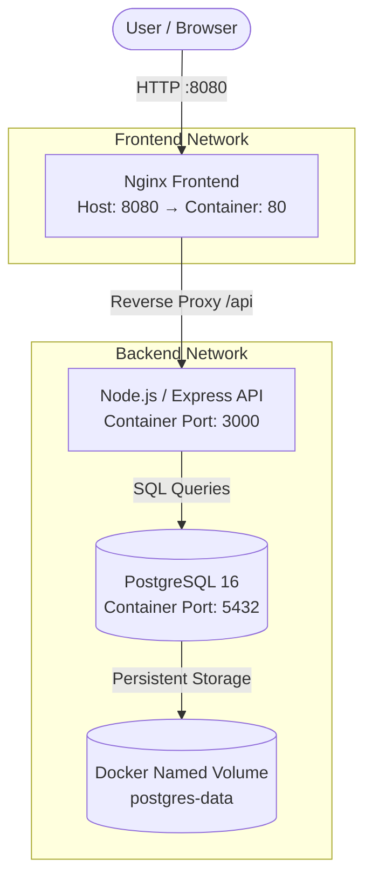

# Zidd — Dockerized Notes Application

A practical three-tier application for learning containerization and core DevOps workflows.

Zidd is a Notes application built using an Nginx frontend, Node.js/Express backend, and PostgreSQL database. This project demonstrates how application services can be containerized, connected, isolated, monitored, and managed using Docker and Docker Compose.

**Technologies:** Docker · Docker Compose · Nginx · Node.js · Express · PostgreSQL · Linux

---

## 1. Application Overview

The application consists of three services, each with one main responsibility.

| Service | Technology | Responsibility |
|---|---|---|
| Frontend | Nginx Alpine | Serves the web interface and reverse-proxies API requests |
| Backend | Node.js and Express | Provides REST API endpoints and handles application logic |
| Database | PostgreSQL 16 Alpine | Stores notes and creation timestamps |

### Application Architecture



### How a Request Travels

1. The browser sends an HTTP request to Nginx on port `8080`.
2. Nginx serves the frontend and forwards `/api/` requests to the backend.
3. The Node.js backend processes the request.
4. The backend communicates with PostgreSQL using the Compose service name `db`.
5. PostgreSQL stores data in the `postgres-data` named volume.

Docker's internal DNS resolves service names to container IP addresses, eliminating the need for hard-coded container IPs.

---

## 2. Docker Networking and Isolation

Two user-defined bridge networks separate the application tiers.

| Network | Connected Services | Purpose |
|---|---|---|
| frontend-net | Frontend and Backend | Handles frontend-to-backend communication |
| backend-net | Backend and Database | Handles backend-to-database communication |

The backend belongs to both networks because it receives API requests from the frontend and communicates with PostgreSQL.

The frontend and database do not share a network, preventing direct frontend-to-database communication through Docker networking.

Only the frontend publishes a host port:

```yaml
ports:
  - "8080:80"
```

The backend and database ports remain internal to the Docker networks.

---

## 3. Project Structure

```text
Dockerized-Notes-application/
├── backend/
│   ├── .dockerignore
│   ├── Dockerfile
│   ├── package.json
│   ├── package-lock.json
│   └── server.js
├── frontend/
│   ├── default.conf
│   └── index.html
├── docs/
│   └── images/
├── .env.example
├── .gitignore
├── LICENSE
├── docker-compose.yml
└── README.md
```

- `backend/` contains the Node.js API and Dockerfile.
- `frontend/` contains the static web interface and Nginx configuration.
- `docker-compose.yml` defines services, networks, volumes, health checks, dependencies, and resource limits.
- `.env.example` documents the required environment variables.

---

## 4. Prerequisites

Before running the application, install:

- Docker Engine
- Docker Compose v2
- Git

Verify the installations:

```bash
docker --version
docker compose version
git --version
```

---

## 5. Run the Application Locally

### Step 1 — Clone the Repository

```bash
git clone https://github.com/kartikkalyanshetti/Dockerized-Notes-application.git

cd Dockerized-Notes-application
```

### Step 2 — Configure Environment Variables

Create your environment file:

```bash
cp .env.example .env
```

Configure your database credentials in `.env`:

```env
POSTGRES_DB=notesdb
POSTGRES_USER=notesuser
POSTGRES_PASSWORD=replace_with_a_strong_password

DB_HOST=db
DB_PORT=5432
DB_NAME=notesdb
DB_USER=notesuser
DB_PASSWORD=replace_with_the_same_password
```

Use matching database credentials for PostgreSQL and the backend.

**Important:** Never commit your actual `.env` file. Only commit `.env.example`.

### Step 3 — Build and Start the Services

```bash
docker compose up -d --build
```

This builds the backend image from the local source code and starts the frontend, backend, and database containers.

### Step 4 — Verify Service Status

```bash
docker compose ps
```

Check that the services are running and that the configured health checks become healthy.

### Step 5 — Access the Application

Open the following URL in your browser:

**http://localhost:8080**

---

## 6. API Reference

| Method | Endpoint | Purpose |
|---|---|---|
| GET | `/api/health` | Checks API and database connectivity |
| GET | `/api/notes` | Retrieves saved notes |
| POST | `/api/notes` | Creates a new note |

### Check API Health

```bash
curl http://localhost:8080/api/health
```

### Retrieve Notes

```bash
curl http://localhost:8080/api/notes
```

### Create a Note

```bash
curl -X POST http://localhost:8080/api/notes \
  -H "Content-Type: application/json" \
  -d '{"content":"My first note from the API"}'
```

---

## 7. Persistence: Docker Named Volumes

PostgreSQL stores database files in the Docker named volume `postgres-data`, mounted at:

```text
/var/lib/postgresql/data
```

This keeps database data separate from the database container's writable layer.

### Test Database Persistence

1. Create a note in the application.
2. Stop and remove the containers:

   ```bash
   docker compose down
   ```

3. Start the application again:

   ```bash
   docker compose up -d
   ```

4. Open the application and verify that the earlier note still exists.

> **Warning:** `docker compose down -v` removes the Compose-managed named volume and deletes the persisted database data. Use it only when you intentionally want to reset the database.

---

## 8. Useful Docker Operations

### View Service Status

```bash
docker compose ps
```

### View Application Logs

```bash
docker compose logs
```

Follow backend logs:

```bash
docker compose logs -f backend
```

### Monitor Resource Usage

```bash
docker stats
```

### Stop the Application

```bash
docker compose down
```

This removes the containers and project networks while retaining the named database volume.

---

## 9. Docker Hub Image

The backend Docker image is published on Docker Hub.

**Image:** `kartik1160/notes-backend:1.0`

### Pull the Published Image

```bash
docker pull kartik1160/notes-backend:1.0
```

**Docker Hub Repository:** [kartik1160/notes-backend](https://hub.docker.com/r/kartik1160/notes-backend)

### Build from Source

The Docker Compose configuration also includes a local build definition for the backend.

To build the image from the checked-out source code and start the application:

```bash
docker compose up -d --build
```

This is useful when modifying the backend source code and creating an updated image.

---

## 10. Security and Configuration

- Do not commit `.env` because it contains credentials.
- Use `.env.example` to document configuration without exposing secrets.
- The backend container runs as a non-root user.
- The database and backend ports are not published to the host in this Compose setup.
- Container memory limits are configured in the Compose file.
- Use `docker stats` to inspect actual container resource usage.

---

## 11. DevOps Concepts Demonstrated

| Area | Implementation |
|---|---|
| Containerization | Custom Dockerfiles |
| Orchestration | Docker Compose |
| Networking | User-defined bridge networks and Docker DNS |
| Reverse Proxy | Nginx |
| Database | PostgreSQL |
| Persistence | Docker named volumes |
| Health Monitoring | Docker health checks |
| Security | Environment variables and non-root backend |
| Resource Management | Container resource limits |
| Linux | Container deployment and operations |
| Version Control | Git and GitHub |
| Image Registry | Docker Hub |

---

## 12. Future Improvements

- Add automated backend and API tests.
- Implement CI/CD using GitHub Actions.
- Deploy the application on AWS EC2.
- Provision infrastructure using Terraform.
- Add monitoring using Prometheus and Grafana.
- Configure a domain name and HTTPS for public deployment.

---

## Author

**Kartik Kalyanshetti**

A hands-on learning project focused on Docker, Linux, networking, application deployment, and DevOps fundamentals.

- [GitHub Repository](https://github.com/kartikkalyanshetti/Dockerized-Notes-application)
- [Docker Hub Image](https://hub.docker.com/r/kartik1160/notes-backend)

